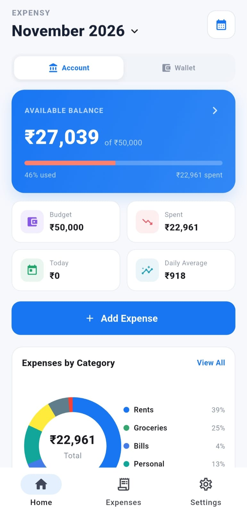
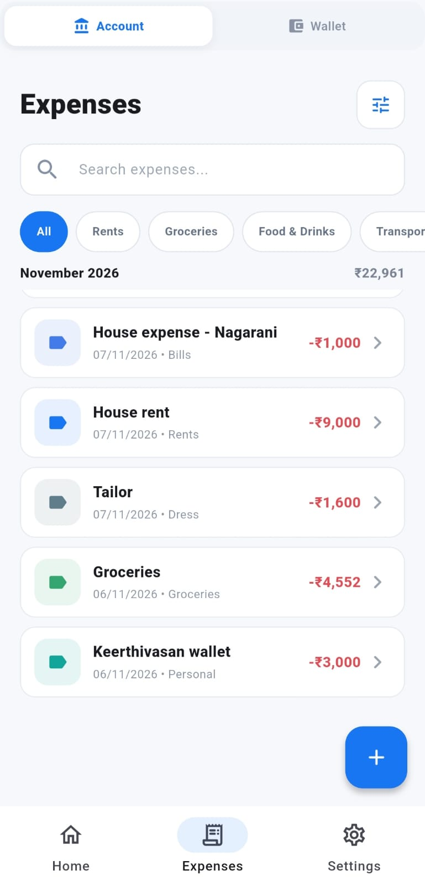
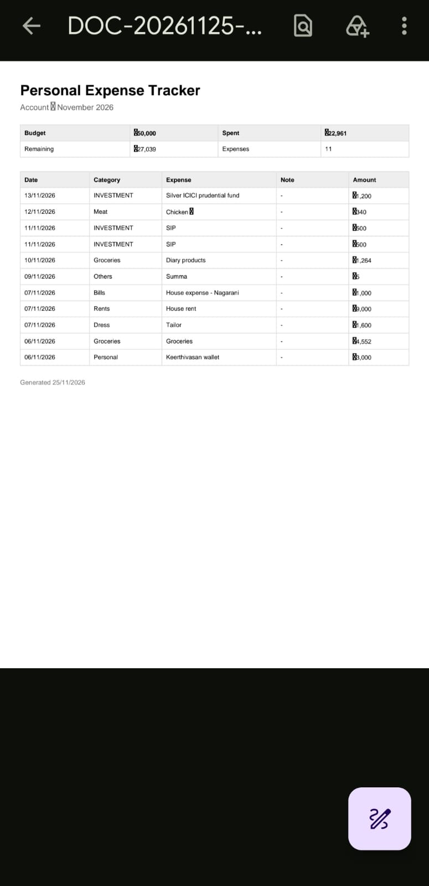
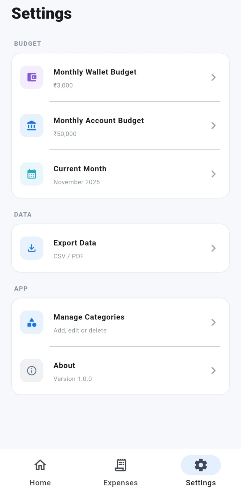

# 💰 EXPENSY – Personal Expense Tracker

<p align="center">
  <strong>Track Smart. Spend Better.</strong>
</p>

<p align="center">
  A Flutter-based mobile application to manage personal expenses, track budgets, and understand spending habits.
</p>

---

## 📌 About the Project

**EXPENSY** is a personal expense tracking mobile application developed using **Flutter and Dart**. It helps users manage their daily expenses, organize transactions by category, monitor monthly budgets, and analyze spending patterns.

The application supports account-wise and wallet-wise expense tracking with local data persistence and CSV/PDF export functionality.

---

## ✨ Features

- **Expense Management:** Add, edit, and delete expenses.
- **Account-wise Budgeting:** Track expenses and budgets through account and wallet modes.
- **Monthly Tracking:** Monitor expenses for individual months.
- **Category-based Analytics:** Visualize spending patterns across different categories.
- **Search Expenses:** Quickly find transactions.
- **Category Filters:** Filter expenses by category.
- **Sorting:** Organize expense records using sorting options.
- **Dynamic Categories:** Add, edit, and delete expense categories.
- **Local Data Storage:** Store expense information locally using SharedPreferences.
- **CSV Export:** Export expense records in CSV format.
- **PDF Export:** Generate PDF reports containing budget details and expense history.
- **Clean User Interface:** Simple and intuitive mobile application design.

---

## 📱 App Screenshots

### 1. Home Dashboard

Displays the available balance, monthly budget, total spending, daily average, and category-wise expense analytics.



### 2. Expense Management

View transactions, search expenses, filter by categories, and manage expense records.



### 3. PDF Expense Report

Generate and view expense reports containing budget information and transaction history.



### 4. Settings and Budget Management

Configure monthly account and wallet budgets, manage categories, and access data export options.



---

## 🛠️ Tech Stack

| Technology | Purpose |
|---|---|
| Flutter | Mobile application development |
| Dart | Programming language |
| SharedPreferences | Local data persistence |
| Material Design | User interface |
| Git | Version control |
| GitHub | Source code hosting |

---

## 📂 Project Structure

```text
EXPENSY/
│
├── android/
├── ios/
├── assets/
│   └── icons/
│
├── lib/
│   ├── main.dart
│   └── ...
│
├── screenshots/
│   ├── home.jpeg
│   ├── expenses.jpeg
│   ├── pdf-export.jpeg
│   └── settings.jpeg
│
├── test/
├── pubspec.yaml
├── README.md
└── .gitignore
```

---

## 🚀 Getting Started

Follow these instructions to run EXPENSY on your local machine.

### Prerequisites

- Flutter SDK
- Dart SDK
- Android Studio or Visual Studio Code
- Android emulator or physical Android device

### Installation

**Step 1: Clone the repository**

```bash
git clone https://github.com/vasanventures-hub/expensy-expense-tracker.git
```

**Step 2: Navigate to the project directory**

```bash
cd expensy-expense-tracker
```

**Step 3: Install dependencies**

```bash
flutter pub get
```

**Step 4: Run the application**

```bash
flutter run
```

---

## 🎯 Project Objective

The main objective of EXPENSY is to provide a simple and effective solution for personal expense management.

It helps users:

- Maintain expense records.
- Monitor monthly budgets.
- Understand category-wise spending.
- Track account and wallet expenses.
- Generate expense reports.

---

## 🔮 Future Enhancements

- Cloud data synchronization.
- User authentication.
- Interactive financial reports.
- Budget notifications and reminders.
- Enhanced iOS application support.

---

## 👨‍💻 Developer

**Keerthivasan**

- GitHub: [@vasanventures-hub](https://github.com/vasanventures-hub)
- Project Repository: [EXPENSY – Personal Expense Tracker](https://github.com/vasanventures-hub/expensy-expense-tracker)

---

## ⭐ Support

If you find this project useful or interesting, consider giving the repository a star!

<p align="center">
  <strong>Built with ❤️ using Flutter and Dart.</strong>
</p>